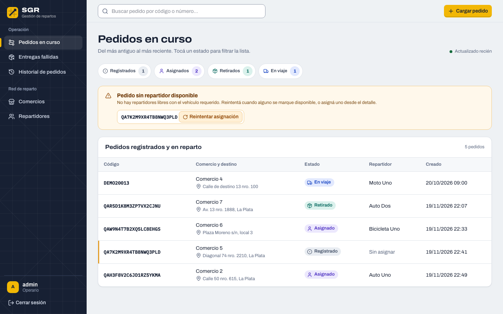
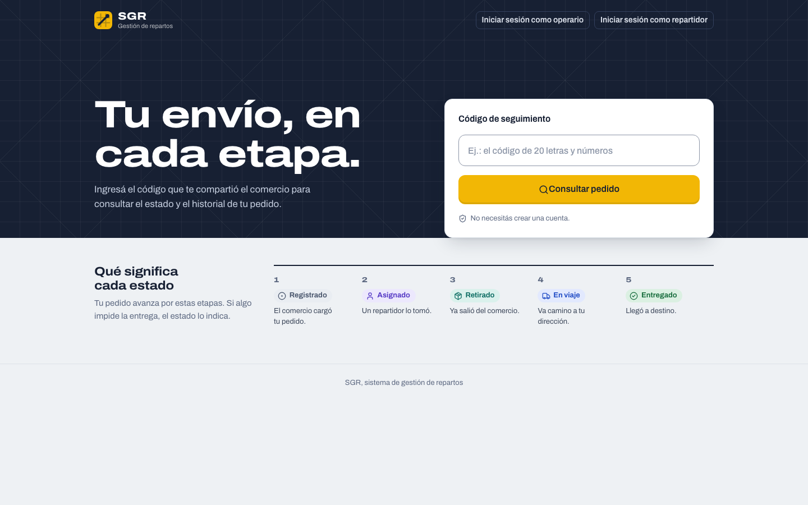
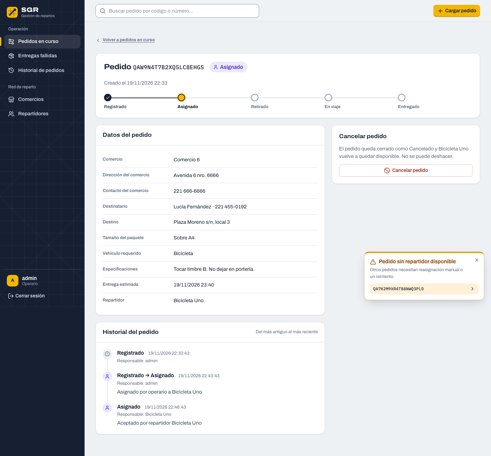
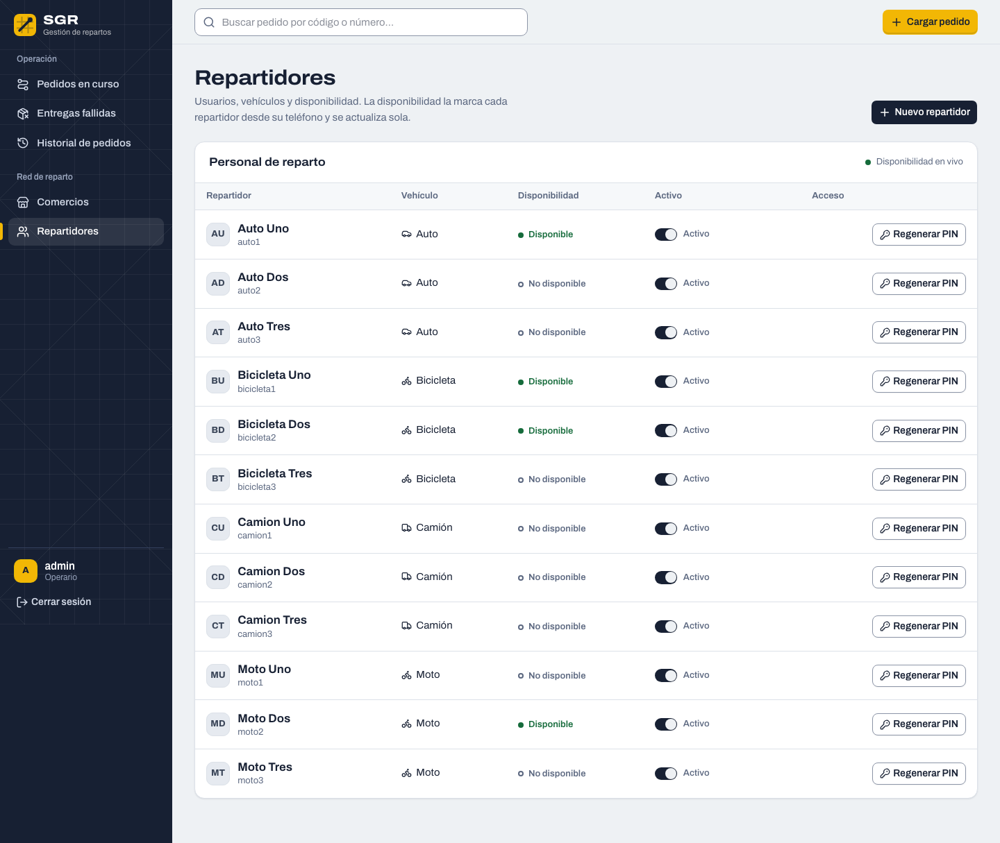
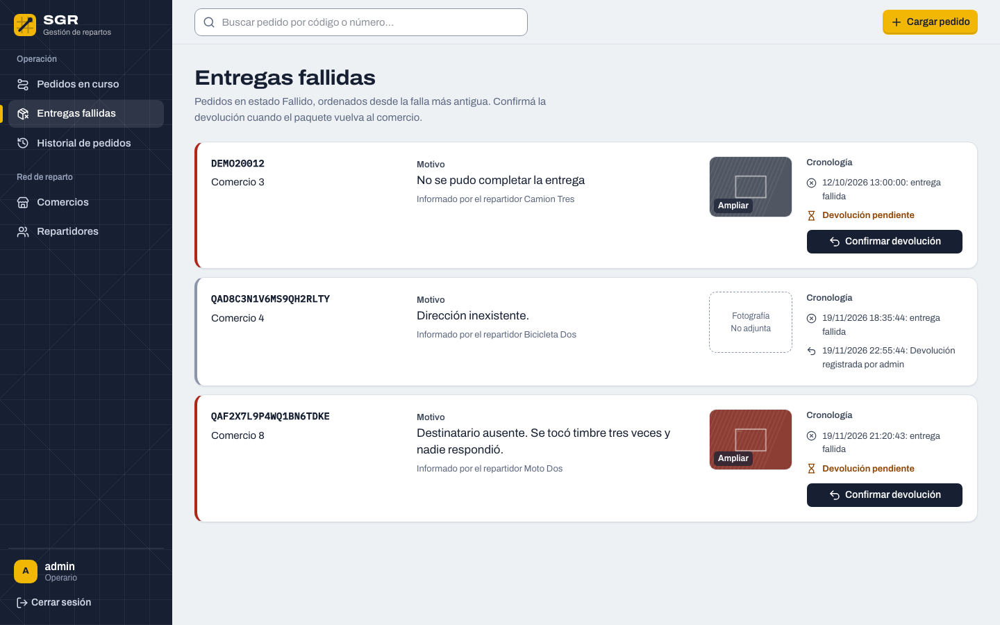
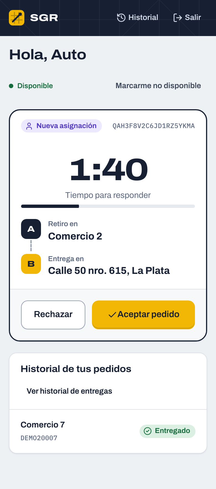
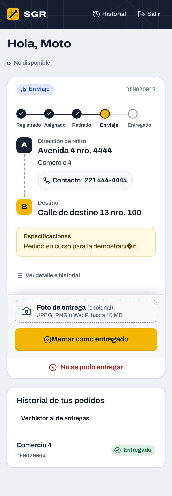
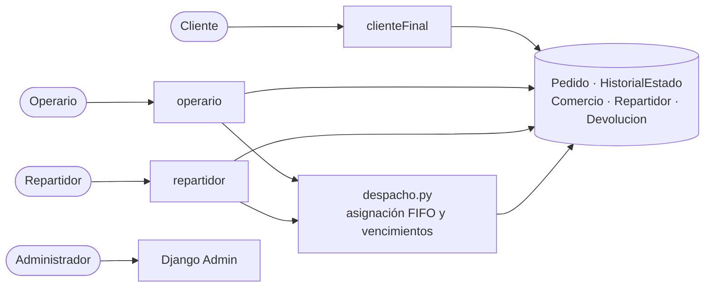
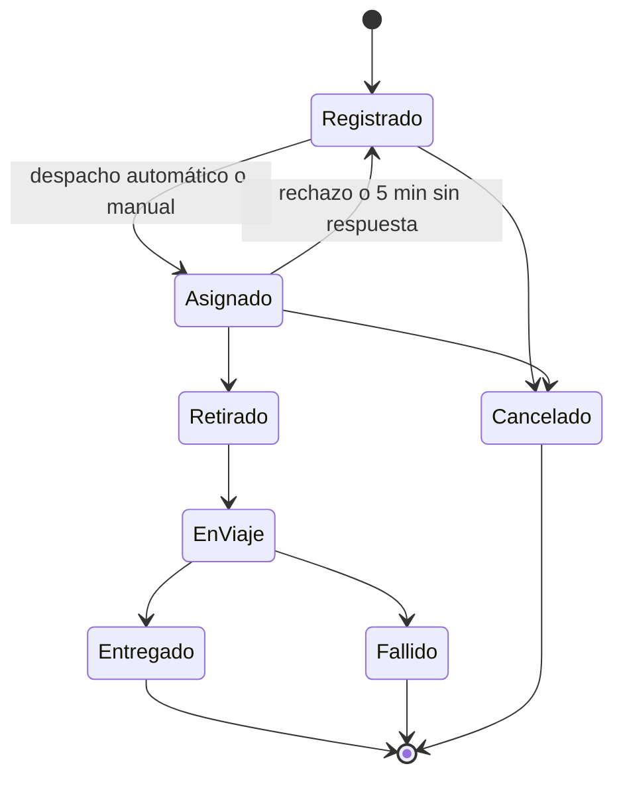

<h1>SGR · Sistema de Gestión de Repartos</h1>

<p>
  
  
  
</p>

Aplicación web para coordinar entregas de última milla entre comercios, un equipo de operación y repartidores. El operario registra los pedidos y los asigna (automáticamente o a mano), el repartidor los acepta y avanza cada etapa desde el teléfono con evidencia fotográfica, y el cliente sigue su envío con un código, sin crear una cuenta.



## Funcionalidades

**Operación (escritorio)**

- Panel de pedidos en curso que se actualiza cada 5 segundos, con filtros por estado y búsqueda por código o número.
- Alta de pedidos con código de seguimiento no predecible, protección contra envíos duplicados y validación del comercio activo.
- Despacho automático FIFO: el pedido va al repartidor disponible hace más tiempo con el vehículo requerido; asignación manual y reintento cuando no hay candidatos.
- Detalle de cada pedido con su recorrido, el historial de cambios y la evidencia fotográfica ampliable.
- Cancelación de pedidos registrados o asignados.
- Gestión de comercios y repartidores: alta, edición, activación y desactivación, disponibilidad en vivo y regeneración del PIN de acceso.
- Entregas fallidas con motivo, foto y confirmación de devolución al comercio.
- Historial general de pedidos con filtros por comercio y estado.

**Reparto (teléfono)**

- Ingreso con un PIN de 4 dígitos y teclado numérico en pantalla.
- Asignaciones con 5 minutos para aceptar o rechazar; al vencer, el pedido pasa al siguiente candidato.
- Una acción por etapa (retirar, iniciar viaje, entregar) con foto opcional, e informe de entrega fallida con motivo obligatorio.
- Interruptor de disponibilidad e historial de entregas.

**Seguimiento público**

- Consulta por código: estado actual, comercio que envía, llegada estimada mientras el pedido está en viaje e historial de estados. No expone datos del destinatario, del repartidor ni fotografías.

## Capturas

| Seguimiento público | Detalle de un pedido |
|---|---|
|  |  |
| **Repartidores** | **Entregas fallidas** |
|  |  |

<table>
  <tr>
    <th>Asignación pendiente</th>
    <th>Entrega en curso</th>
    <th>Seguimiento en el teléfono</th>
  </tr>
  <tr>
    <td></td>
    <td></td>
    <td></td>
  </tr>
</table>

Las capturas se tomaron con datos de prueba basados en los [datos de demostración](demo/README.md); todos los nombres, teléfonos y direcciones son ficticios.

## Tecnologías

| Capa | Tecnología |
|---|---|
| Backend | Python 3.14, Django 6.1 |
| Base de datos | SQLite (desarrollo) o PostgreSQL vía `DATABASE_URL` (usado con Neon durante el desarrollo), con `dj-database-url` y Psycopg 3 |
| Interfaz | Plantillas Django, [Basecoat UI](https://basecoatui.com) 1.1.0 incluido en el repositorio, CSS y JavaScript propios sin paso de build, íconos [Lucide](https://lucide.dev) |
| Imágenes | Pillow (validación y compresión de fotografías) |

## Arquitectura

Monolito Django con una aplicación por responsabilidad y una interfaz renderizada en el servidor.



| Aplicación | Responsabilidad |
|---|---|
| `main.homePage` | Entrada pública y redirección de cada sesión a su panel |
| `main.operario` | Comercios, alta y detalle de pedidos, asignación, repartidores, fallidos y devoluciones |
| `main.repartidor` | Pedido, historial de estados, perfil del repartidor, ingreso por PIN y evidencia |
| `main.clienteFinal` | Seguimiento público de solo lectura |
| `main.users` | Usuario extendido con el rol de operario |

Ciclo de vida de un pedido:



Más detalle en [docs/ARQUITECTURA.md](docs/ARQUITECTURA.md) (backend y modelo de datos) y [docs/ARQUITECTURA-FRONTEND.md](docs/ARQUITECTURA-FRONTEND.md) (plantillas y sistema de diseño).

## Instalación

Requisitos: Python 3.14 y Git. No hace falta Node ni un servicio de base de datos.

```bash
git clone https://github.com/M4teee/Ingenieria-en-Software-2026.git
cd Ingenieria-en-Software-2026
python3.14 -m venv .venv
source .venv/bin/activate        # Windows: .venv\Scripts\Activate.ps1
python -m pip install -r requirements.txt
cd Backend
python manage.py migrate
python manage.py createsuperuser
python manage.py runserver
```

La aplicación queda en `http://127.0.0.1:8000/`. Para recorrerla con datos ya cargados, seguí [demo/README.md](demo/README.md). La [guía de ejecución](docs/GUIA-EJECUCION-Y-PRUEBAS.md) cubre Windows, PostgreSQL y los errores frecuentes.

### Variables de entorno

Opcionales. Se leen de un archivo `.env` en la raíz (copiá [.env.example](.env.example)).

| Variable | Uso | Si no se define |
|---|---|---|
| `DJANGO_SECRET_KEY` | Clave secreta de Django | Clave de desarrollo pública |
| `DATABASE_URL` | Conexión PostgreSQL (`postgres://` o `postgresql://`) | SQLite en `Backend/db.sqlite3` |

### Roles y accesos

| Rol | Cómo se crea | Entrada |
|---|---|---|
| Operario | Usuario con `is_operario` (desde Django Admin) | `/login/` → `/operario/` |
| Repartidor | Desde el panel del operario (**Repartidores → Nuevo repartidor**) | `/repartidor/login-pin/` |
| Administrador | `createsuperuser` o usuario con `is_staff` | `/admin/` |
| Cliente | No necesita cuenta | `/` |

## Tests

```bash
cd Backend
python manage.py test --settings=config.settings_test
```

`config.settings_test` usa SQLite en memoria y nunca se conecta a la base configurada en `DATABASE_URL`. La suite tiene 182 pruebas que cubren permisos, alta e idempotencia, despacho y vencimientos, transiciones de estado, fotografías, seguimiento público y plantillas.

## Estructura del proyecto

```
Backend/
├── config/            Ajustes de Django (desarrollo y tests), URLs, ASGI/WSGI
├── main/              Aplicaciones: homePage, operario, repartidor, clienteFinal, users
│   └── despacho.py    Asignación automática y vencimiento de asignaciones
├── templates/         layouts/ por rol, components/ reutilizables y pantallas por aplicación
└── static/            sgr/ (sistema de diseño), vendor/ (Basecoat UI), css/ y js/
demo/                  Datos de demostración y script para cargarlos
docs/                  Guía, manual, arquitectura y sistema de diseño
└── proyecto/          Registro académico: requisitos, decisiones, estado y fuentes
scripts/check_docs.py  Verificación de enlaces de la documentación
```

## Estado y limitaciones

La configuración incluida es de **desarrollo**: `DEBUG` activo, sin HTTPS y sin límite de intentos en el ingreso por PIN. No la expongas a Internet sin seguir [SECURITY.md](SECURITY.md). No hay notificaciones externas (el repartidor ve las asignaciones al abrir o actualizar su panel) ni cálculo de cercanía geográfica.

## Documentación

- [Guía de ejecución y pruebas](docs/GUIA-EJECUCION-Y-PRUEBAS.md)
- [Manual de uso por rol](docs/MANUAL-DE-USO.md)
- [Índice completo](docs/INDEX.md)
- [Cómo contribuir](CONTRIBUTING.md) · [Seguridad](SECURITY.md)

## Contexto

Proyecto de la materia Ingeniería en Software (2026). Los requisitos, entrevistas y decisiones del proceso están en [docs/proyecto/](docs/INDEX.md#registro-del-proyecto).

## Licencia

El repositorio todavía no declara una licencia. Hasta que se agregue un archivo `LICENSE`, el código no tiene permisos de uso o redistribución otorgados.
