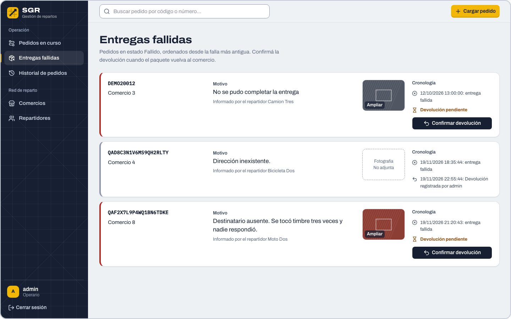
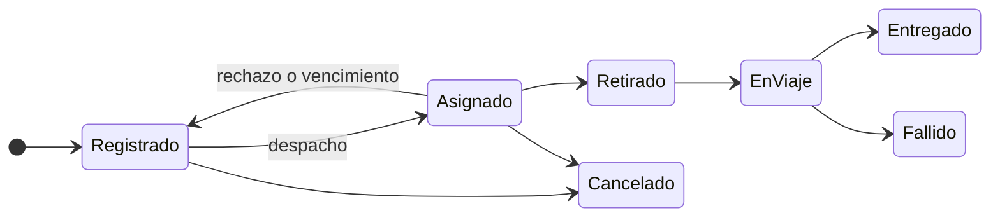

<p align="center">
  
</p>

<p align="center">
  
  
  
  
</p>

SGR coordina entregas de última milla entre comercios, un equipo de operación y repartidores. El operario registra los pedidos y el sistema los asigna, el repartidor avanza cada etapa desde el teléfono con evidencia fotográfica y el cliente sigue su envío con un código, sin crear una cuenta.

<p align="center">
  
</p>

## Qué hace

<table>
  <tr>
    <td width="33%" valign="top">
      <strong>Operación</strong><br>
      Panel en vivo de pedidos en curso, alta con código de seguimiento, despacho automático al repartidor disponible hace más tiempo, asignación manual, cancelación, comercios, repartidores, entregas fallidas y devoluciones.
    </td>
    <td width="33%" valign="top">
      <strong>Reparto</strong><br>
      Ingreso con PIN, cinco minutos para aceptar cada asignación, una acción por etapa con foto opcional, informe de entrega fallida con motivo e historial de entregas.
    </td>
    <td width="33%" valign="top">
      <strong>Seguimiento</strong><br>
      Estado, comercio, llegada estimada mientras el pedido viaja e historial de estados. Sin datos del destinatario, del repartidor ni fotografías.
    </td>
  </tr>
</table>

## Pantallas

<table>
  <tr>
    <td width="50%"></td>
    <td width="50%"></td>
  </tr>
  <tr>
    <td align="center"><sub>Seguimiento público</sub></td>
    <td align="center"><sub>Detalle de un pedido con su recorrido</sub></td>
  </tr>
  <tr>
    <td width="50%"></td>
    <td width="50%"></td>
  </tr>
  <tr>
    <td align="center"><sub>Repartidores con disponibilidad en vivo</sub></td>
    <td align="center"><sub>Entregas fallidas y devoluciones</sub></td>
  </tr>
</table>

<p align="center">
  
  &nbsp;&nbsp;&nbsp;&nbsp;
  
  <br>
  <sub>El repartidor y el cliente usan la aplicación desde el teléfono.</sub>
</p>

<sub>Datos ficticios basados en los <a href="demo/README.md">datos de demostración</a>.</sub>

## Cómo funciona



Monolito Django con una aplicación por rol (`operario`, `repartidor`, `clienteFinal`) y una interfaz renderizada en el servidor con [Basecoat UI](https://basecoatui.com) y un sistema de diseño propio, sin Node ni paso de build. Detalle en [docs/arquitectura.md](docs/arquitectura.md).

## Empezar

Requisitos: Python 3.14 y Git.

```bash
git clone https://github.com/M4teee/Ingenieria-en-Software-2026.git
cd Ingenieria-en-Software-2026
python3.14 -m venv .venv
source .venv/bin/activate          # Windows: .venv\Scripts\Activate.ps1
python -m pip install -r requirements.txt
cd Backend
python manage.py migrate
python manage.py createsuperuser
python manage.py runserver
```

Abrí `http://127.0.0.1:8000/`. Para recorrerla con datos cargados, usá los [datos de demostración](demo/README.md).

| Rol | Entrada | Acceso |
|---|---|---|
| Cliente | `/` | Sin cuenta |
| Operario | `/login/` | Usuario con `is_operario` (se habilita en Django Admin) |
| Repartidor | `/repartidor/login-pin/` | PIN de 4 dígitos, lo crea el operario |
| Administrador | `/admin/` | `createsuperuser` o usuario `is_staff` |

Variables opcionales en `.env` (ver [.env.example](.env.example)): `DJANGO_SECRET_KEY` y `DATABASE_URL` (PostgreSQL; sin ella, SQLite).

```bash
cd Backend
python manage.py test --settings=config.settings_test   # 182 pruebas, SQLite en memoria
```

## Documentación

| | |
|---|---|
| [Instalación y pruebas](docs/instalacion.md) | Windows, PostgreSQL/Neon y errores frecuentes |
| [Arquitectura](docs/arquitectura.md) | Aplicaciones, modelo de datos, flujo de un pedido e interfaz |
| [Sistema de diseño](docs/diseno.md) | Paleta, tipografía y composición por rol |
| [Estado](docs/estado.md) | Cobertura del backlog, decisiones vigentes y limitaciones |
| [Fuentes](docs/fuentes/README.md) | Entrevistas, requisitos y backlog originales |
| [Contribuir](CONTRIBUTING.md) · [Seguridad](SECURITY.md) | Pautas y reporte de vulnerabilidades |

> La configuración incluida es de **desarrollo** (`DEBUG` activo, sin HTTPS ni límite de intentos para el PIN). Antes de exponerla, seguí [SECURITY.md](SECURITY.md).

---

<sub>Trabajo práctico de Ingeniería en Software, 2026. El repositorio todavía no declara una licencia.</sub>
