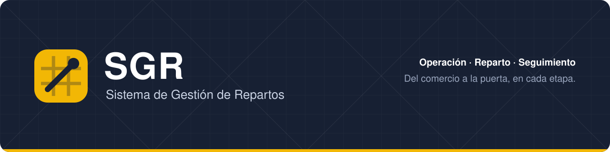
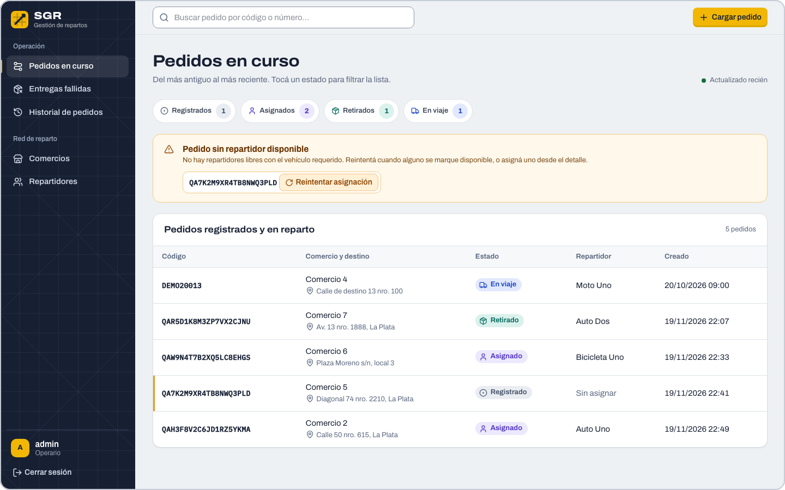
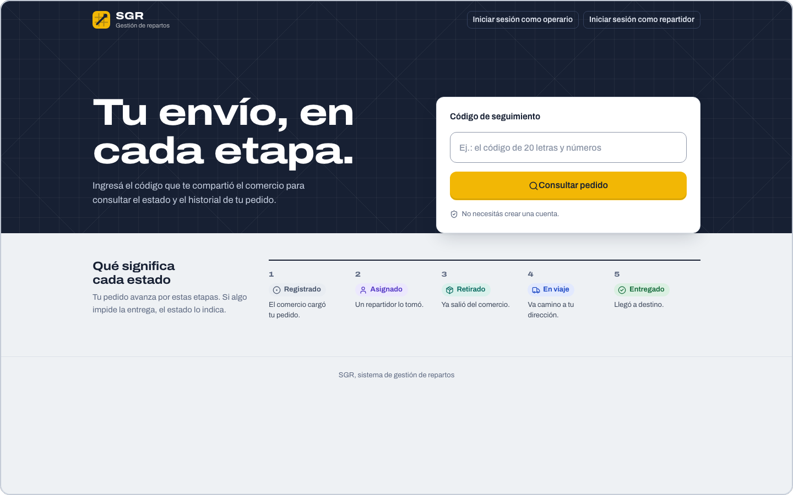
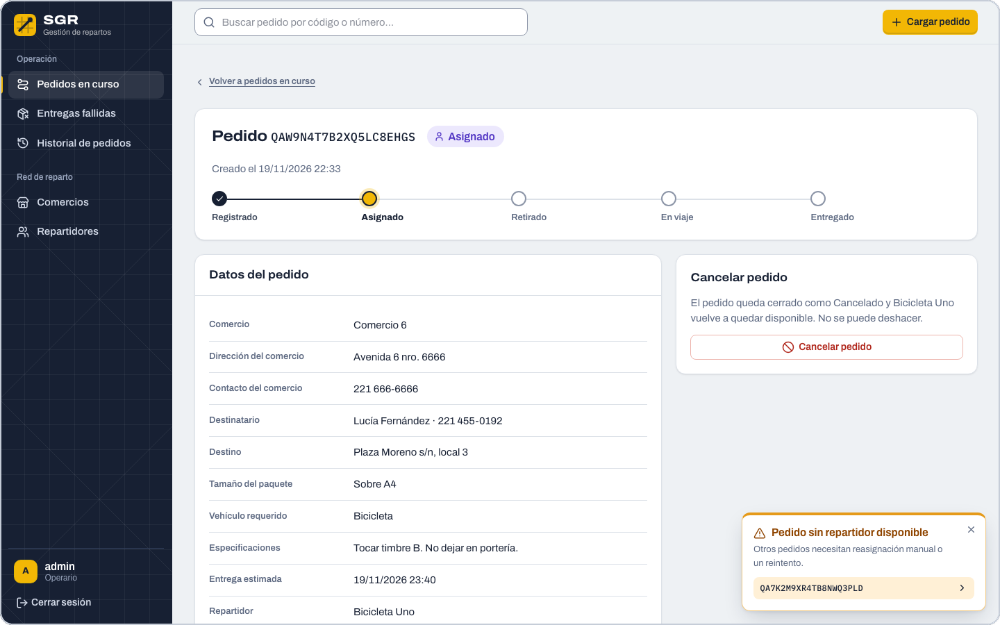
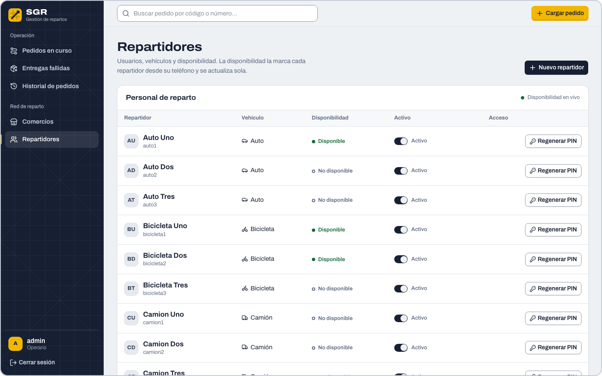
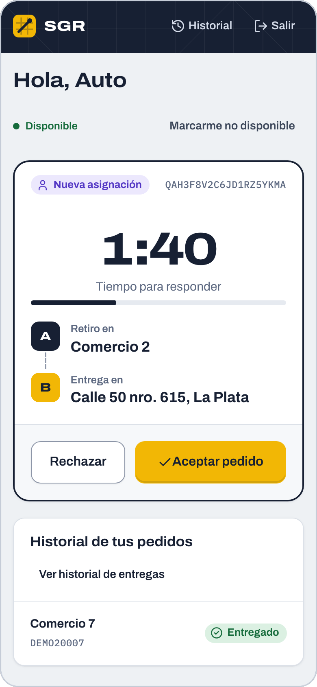
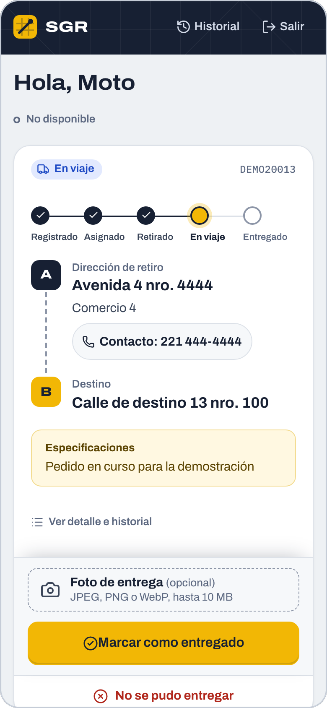
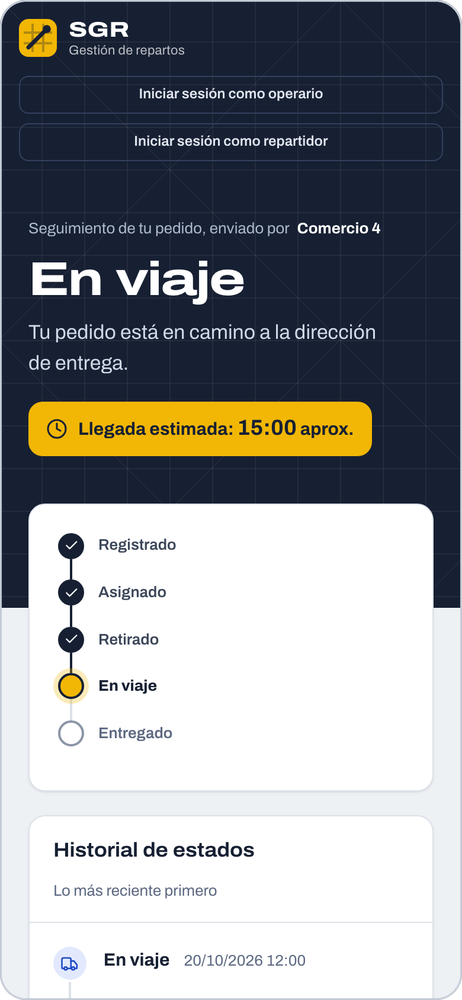
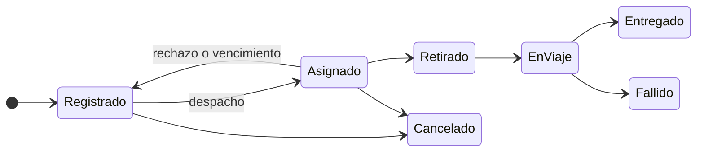

<p align="center">
  
</p>

<p align="center">
  <b>Coordinación de entregas de última milla entre comercios, operación y repartidores.</b><br>
  <sub>Pedidos con asignación automática, seguimiento por etapas y evidencia fotográfica, todo en una aplicación web.</sub>
</p>

<p align="center">
  
  
  
  
</p>

<p align="center">
  <a href="#qué-hace">Qué hace</a>&nbsp;&nbsp;·&nbsp;&nbsp;
  <a href="#pantallas">Pantallas</a>&nbsp;&nbsp;·&nbsp;&nbsp;
  <a href="#cómo-funciona">Cómo funciona</a>&nbsp;&nbsp;·&nbsp;&nbsp;
  <a href="#empezar">Empezar</a>&nbsp;&nbsp;·&nbsp;&nbsp;
  <a href="#documentación">Documentación</a>
</p>

<br>

<p align="center">
  
</p>

<br>

## Qué hace

Un comercio pide un envío, el operario lo registra y SGR busca un repartidor libre con el vehículo adecuado. El repartidor lo acepta desde el teléfono y marca cada etapa hasta la entrega. El cliente, con el código que le pasó el comercio, ve en qué punto está su pedido.

<br>

<table>
  <tr>
    <td width="33%" valign="top">
      <br><br>
      <b>Operación</b><br><br>
      Panel de pedidos que se actualiza solo<br><br>
      Despacho automático y asignación manual<br><br>
      Comercios, repartidores y PIN de acceso<br><br>
      Entregas fallidas y devoluciones
    </td>
    <td width="33%" valign="top">
      <br><br>
      <b>Reparto</b><br><br>
      Ingreso con un PIN de 4 dígitos<br><br>
      Cinco minutos para aceptar cada pedido<br><br>
      Una acción por etapa, con foto opcional<br><br>
      Historial de entregas propias
    </td>
    <td width="33%" valign="top">
      <br><br>
      <b>Seguimiento</b><br><br>
      Consulta con el código, sin cuenta<br><br>
      Estado y etapas del recorrido<br><br>
      Hora estimada mientras viaja<br><br>
      Sin datos personales ni fotos
    </td>
  </tr>
</table>

<br>

## Pantallas

<br>

<table>
  <tr>
    <td width="50%" align="center">
      <br>
      <sub><b>Seguimiento público</b><br>El cliente consulta su pedido con el código.</sub>
    </td>
    <td width="50%" align="center">
      <br>
      <sub><b>Detalle del pedido</b><br>Recorrido, datos, historial y acciones.</sub>
    </td>
  </tr>
  <tr><td colspan="2">&nbsp;</td></tr>
  <tr>
    <td width="50%" align="center">
      <br>
      <sub><b>Repartidores</b><br>Disponibilidad en vivo, cuentas y PIN.</sub>
    </td>
    <td width="50%" align="center">
      <br>
      <sub><b>Entregas fallidas</b><br>Motivo, evidencia y devolución al comercio.</sub>
    </td>
  </tr>
</table>

<br>

<table>
  <tr>
    <td width="33%" align="center">
      <br>
      <sub><b>Nueva asignación</b><br>Aceptar o rechazar antes de que venza.</sub>
    </td>
    <td width="33%" align="center">
      <br>
      <sub><b>Entrega en curso</b><br>Retiro, destino y la próxima acción.</sub>
    </td>
    <td width="33%" align="center">
      <br>
      <sub><b>Seguimiento en el teléfono</b><br>Estado, llegada estimada y etapas.</sub>
    </td>
  </tr>
</table>

<p align="center"><sub>Capturas con datos ficticios basados en los <a href="demo/README.md">datos de demostración</a>.</sub></p>

<br>

## Cómo funciona



1. **Registro.** El operario carga el pedido y SGR genera un código de seguimiento único.
2. **Despacho.** El pedido va al repartidor disponible hace más tiempo con el vehículo requerido. Si no hay ninguno, queda marcado para reintentar o asignar a mano.
3. **Respuesta.** El repartidor tiene cinco minutos para aceptar. Si rechaza o no responde, el pedido pasa al siguiente candidato.
4. **Recorrido.** Cada etapa queda en el historial, con foto opcional al retirar, entregar o informar una falla.

<br>

| | |
|---|---|
| **Backend** | Django 6.1 con una aplicación por rol: `operario`, `repartidor` y `clienteFinal` |
| **Interfaz** | Plantillas renderizadas en el servidor, [Basecoat UI](https://basecoatui.com) e íconos [Lucide](https://lucide.dev), sin Node ni paso de build |
| **Datos** | SQLite para desarrollo o PostgreSQL vía `DATABASE_URL` (usado con Neon) |
| **Fotos** | Pillow valida y comprime la evidencia antes de guardarla |

Detalle en [docs/arquitectura.md](docs/arquitectura.md).

<br>

## Empezar

Necesitás **Python 3.14** y **Git**.

**1. Instalar**

```bash
git clone https://github.com/M4teee/Ingenieria-en-Software-2026.git
cd Ingenieria-en-Software-2026
python3.14 -m venv .venv
source .venv/bin/activate          # Windows: .venv\Scripts\Activate.ps1
python -m pip install -r requirements.txt
```

**2. Preparar la base y levantar el servidor**

```bash
cd Backend
python manage.py migrate
python manage.py createsuperuser
python manage.py runserver
```

Abrí <http://127.0.0.1:8000/>. Para recorrerla con pedidos, comercios y repartidores ya cargados, usá los [datos de demostración](demo/README.md).

**3. Correr las pruebas**

```bash
python manage.py test --settings=config.settings_test
```

182 pruebas sobre SQLite en memoria. No tocan tu base local ni la remota.

<br>

| Rol | Entrada | Cómo se habilita |
|---|---|---|
| Cliente | `/` | No necesita cuenta |
| Operario | `/login/` | Usuario con `is_operario`, desde Django Admin |
| Repartidor | `/repartidor/login-pin/` | El operario lo crea y le asigna un PIN |
| Administrador | `/admin/` | `createsuperuser` o usuario `is_staff` |

Variables opcionales en `.env` (partí de [.env.example](.env.example)): `DJANGO_SECRET_KEY` y `DATABASE_URL`. Sin `DATABASE_URL` se usa SQLite. Para conectar PostgreSQL o Neon, seguí [docs/instalacion.md](docs/instalacion.md).

> [!WARNING]
> La configuración incluida es de **desarrollo**: `DEBUG` activo, sin HTTPS y sin límite de intentos para el PIN. Antes de exponerla, seguí [SECURITY.md](SECURITY.md).

<br>

## Documentación

| Documento | Para qué |
|---|---|
| [Instalación y pruebas](docs/instalacion.md) | Windows, PostgreSQL/Neon y errores frecuentes |
| [Arquitectura](docs/arquitectura.md) | Aplicaciones, modelo de datos, flujo de un pedido e interfaz |
| [Sistema de diseño](docs/diseno.md) | Paleta, tipografía y composición por rol |
| [Estado](docs/estado.md) | Cobertura del backlog, decisiones vigentes y limitaciones |
| [Fuentes](docs/fuentes/README.md) | Entrevistas, requisitos y backlog originales |
| [Contribuir](CONTRIBUTING.md) | Ramas, pruebas y documentación |
| [Seguridad](SECURITY.md) | Alcance de la configuración y reporte de vulnerabilidades |

<br>

---

<p align="center">
  <sub>Trabajo práctico de Ingeniería en Software, 2026.<br>El repositorio todavía no declara una licencia.</sub>
</p>
